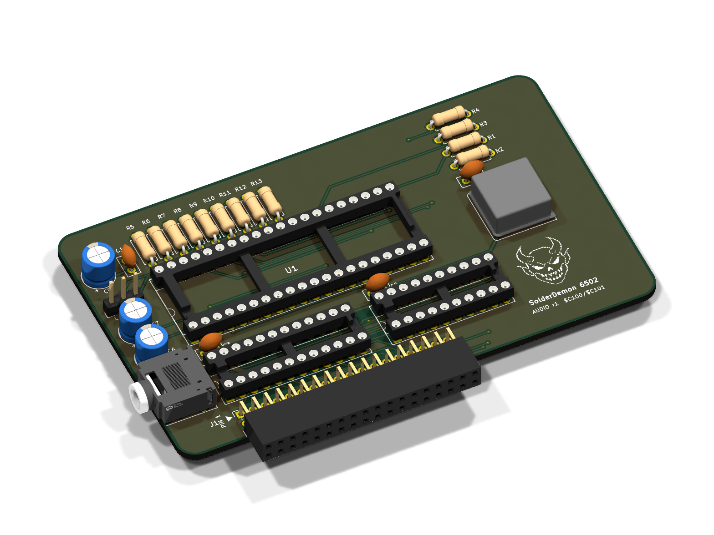

# SolderDemon 6502 Audio Board

A YM2149F programmable sound generator card for the SolderDemon 6502 single-board computer, a descendant of [rosco_6502](https://github.com/rosco-m68k/rosco_6502) that keeps its expansion bus.

It is the 6502 sibling of the SolderDemon m68k Audio card and works the same way: the PSG sits behind a data latch and a GAL sequencer that times the strobes in hardware. The CPU stores a register number at `$C100` and a value at `$C101`; the card holds the CPU with `RDY` (the 6502's counterpart of `/DTACK`) for the ~4 µs the PSG needs. Three tone channels, noise and envelope, passive ABC stereo line out.



> **Status:** r1. Schematic and PCB complete: ERC 0, DRC 0 violations, 0 unconnected, 0 schematic-parity issues. The sequencer is simulated from its JEDEC fuse map with bus timing at 14, 10, 4, 1 and 0.25 MHz; the driver runs on a 65C02 model. **No physical prototype has been built or tested yet.**

## Compared with rosco_6502-audio

The card replaces the first SolderDemon attempt, `rosco_6502-audio` moved onto the SolderDemon socket unchanged (never built): a W65C22S VIA drove `BC1`/`BDIR` from software, with `NOP`s timing the strobe, an ATF16V8 decoded the VIA and a 2.000 MHz can clocked the PSG.

| | rosco_6502-audio port | r1 |
|---|---|---|
| Bus interface | W65C22S VIA + ATF16V8B decoder | ATF22V10C-7 sequencer + 74HCT273 latch, as on the m68k card |
| PSG write | 2 VIA stores per strobe, 4 per register, timed by `NOP` | 2 plain stores: register number, value |
| Strobe length | 0.5–6 µs, set by the CPU clock; NMI or single-step could break 10 µs | 1.09 µs from the PSG clock, at any CPU clock |
| CPU clock | 1–10 MHz | any, to 14 MHz |
| PSG clock | 2.000 MHz, on Yamaha's limit | 1.8432 MHz, as on the m68k card |
| Bus lines | A0–A3, A8–A15, `~IRQ` (diode) | A0, A8–A15, `RDY`; no `~IRQ` |
| ICs | 3 + can (2 × DIP-40) | 3 + can |
| Board | 100 × 90 mm, R4 | 60 × 100 mm: as deep as the busboard, 60 mm high; jack on the side |

What r1 gives up: the VIA's timers and interrupt. Playback ticks come from the host (the DUART timer).

## Highlights

- **Sound generator:** Yamaha **YM2149F** (`U1`, DIP-40), clocked by a **1.8432 MHz 5 V can** (`X1`) with `SEL` high.
- **Hardware-timed interface:** **ATF22V10C-7PX** (`U3`) decodes a write to `$C100–$C1FF`, pulls `RDY`, latches the byte into a **74HCT273** (`U2`), raises `BDIR` for two PSG clocks and drives `RDY` high again. `A0` drives `BC2` directly, `BC1` is grounded.
- **Shared-line hygiene:** `RDY` is enabled only in PHI2 high of the card's own write and driven high before it is let go (the host's pull-up is 3k3); it never sees an address-decode glitch.
- **Write-only, read-safe:** reads of the page do nothing and are not stretched; the PSG never drives the bus.
- **Passive ABC stereo:** A left, C right, B in both at about −6.9 dB; AC coupled, 100 kΩ bleeders.
- **Two outputs:** 3.5 mm **PJ-307** jack (`J2`, HOOYA, LCSC `C2939173`) on the top side edge, flush with the busboard's top (pin 1) edge, so it can go through a case wall like a PC card's bracket, and a 1×3 header (`J3`: L / GND / R).
- **Busboard form factor:** 60 × 100 mm, 2 layers, R4 corners, no mounting holes. 100 mm is the busboard's depth, so both side edges are flush with it and with the host; the card stands 60 mm tall. Copyright on the solder side.
- **100 % through-hole**, all ICs socketed.

## Memory Map

| Address | Access | Function |
|:---|:---|:---|
| **`$C100`** | write | PSG register number (A0 = 0 → `BC2` = 0: latch address) |
| **`$C101`** | write | value for that register (A0 = 1 → `BC2` = 1: write) |
| `$C102–$C1FF` | — | mirrors (A1–A7 not decoded); treat the page as occupied |
| reads | — | ignored, no wait state; the bus floats |

The DUART is at `$C000–$C00F`, the RAM board at `$CE00`/`$CF00` and `$D000–$DFFF`. `$C100` is this project's choice, not an upstream allocation.

## Operating Principle

```text
       SolderDemon 6502 bus (J1)
   A8..A15 PHI2 RWB ~RESET      D0..D7          A0
        |                        |              |
        v                        v              |
 +----------------+  CAPTURE +-----------+      |
 | U3 ATF22V10C-7 |--------->| U2 74HCT273|     |
 |  decode + 3-bit|          +-----------+      |
 |  Gray counter  |                | DA0..DA7   | BC2      BC1 = GND
 +----------------+  BDIR          v            v
   |  RDY  ^ CLK  -------->  +------------------------+
   v       |                 |       U1 YM2149F       |
  bus     X1 1.8432 MHz ---->|  CLOCK, SEL high       |
                             +------------------------+
                                A      B      C
                             1k loads, ABC mixer, 10 uF, 100k
                                  J2 3.5 mm / J3 L G R
```

1. **Request.** A write to `$C1xx` while `/RESET` is high. In PHI2 high `U3` pulls `RDY` low; the W65C02S holds and repeats the write cycle.
2. **Capture.** `CAPTURE` rises at every PHI2 fall of the held cycle, so `U2` holds the byte.
3. **Count.** The 3-bit Gray counter, clocked by `X1`, starts on the first edge that sees PHI2 high and stops capturing at state 3.
4. **Strobe.** `BDIR` is high in states 4–5: 1085 ns, with `BC2` = `A0` and the data stable for at least 543 ns before and after.
5. **Release.** At state 7 `RDY` is driven high; the CPU finishes the cycle, the address changes, `U3` lets go of `RDY` and resets.

Timing budget: [docs/TIMING.md](docs/TIMING.md).

## Programming Example

```asm
PSG_REG  = $C100
PSG_DATA = $C101

; A = value, X = register. IRQs off so a handler cannot get between the two stores.
psg_write:
    php
    sei
    pha
    txa
    and #$0F
    sta PSG_REG         ; register number
    pla
    sta PSG_DATA        ; value
    plp
    rts
```

`code/demo/psg.s` has `psg_write`, `psg_init` (all registers 0, mixer `$3F`), `psg_silence` and `psg_test_chord` (C4–E4–G4 at 1.8432 MHz: periods 440, 349, 294). There is no delay anywhere: the card holds the CPU as long as it needs.

```sh
ca65 code/demo/psg.s -l code/demo/psg.lst
ca65 code/demo/demo.s
ld65 -C code/demo/demo.cfg -o code/demo/demo.bin -m code/demo/demo.map -Ln code/demo/demo.lbl code/demo/demo.o code/demo/psg.o
```

The demo loads at `$1000`: `JSR $1000` leaves the chord playing.

## Bill of Materials

| Reference | Value | Package | Notes |
|:---|:---|:---|:---|
| **U1** | YM2149F | DIP-40, 15.24 mm | Socket it. AliExpress lots are not guaranteed genuine. |
| **U2** | 74HCT273 | DIP-20 | Data latch. HCT, not HC: its D inputs see the CPU bus. |
| **U3** | ATF22V10C-7PX | DIP-24, 7.62 mm | Sequencer. **-7** needed for `RDY` at 14 MHz; -10/-15 only to 10 MHz. Power-down off. |
| **X1** | 1.8432 MHz, 5 V | Oscillator DIP-8 | Can, not a crystal. Pin 1 enable or NC. |
| **J1** | 2×18 female, right angle | 2.54 mm | The host's `J5` footprint, component side. |
| **J2** | PJ-307 | 3.5 mm TRS, horizontal | S = GND, T = left, R = right, switch pins unused. |
| **J3** | 1×3 header | 2.54 mm | L / GND / R. |
| **R1, R2** | 33 Ω | Axial | Clock series resistors to U1 and U3. |
| **R3, R4** | 10 kΩ | Axial | `BDIR` and `CAPTURE` pull-downs. |
| **R5–R7** | 1 kΩ | Axial | Channel loads A/B/C (1 % preferred). |
| **R8, R11** | 10 kΩ | Axial | A → left, C → right. |
| **R9, R10** | 22 kΩ | Axial | B → left and right. |
| **R12, R13** | 100 kΩ | Axial | Output bleeders. |
| **C1–C4** | 100 nF | Disc, P2.5 mm | U1, U2, U3, X1. |
| **C5** | 47 µF / 16 V | Radial D6.3 mm | Bulk at J1. |
| **C6, C7** | 10 µF / 16 V | Radial D6.3 mm | Output coupling, `+` to the mixer. |

Plus sockets: 1 × DIP-40, 1 × DIP-24, 1 × DIP-20. [BOM.csv](BOM.csv). Budget 250 mA at 5 V (not measured). Keep parts under about 11 mm for the 20 mm slot pitch.

## PLD Firmware (U3)

Source `code/pld/audio_sequencer.pld` (GALasm), image `code/pld/audio_sequencer.jed`:

```sh
galasm code/pld/audio_sequencer.pld
minipro -p ATF22V10C -w code/pld/audio_sequencer.jed
```

Program as ATF22V10C, verify after writing. Do not use an ATF16V8: neither the pins nor the fuse map fit.

## First Power-Up

1. Power off: check `J1` orientation, electrolytic polarity, no +5 V–GND short; check X1's pin 1 function.
2. Program and verify `U3`. Fit the ICs by their pin 1 marks.
3. Run the host at 1–2 MHz first. 5 V on `U1`-40, `U2`-20, `U3`-24; 1.8432 MHz on `U1`-22; `U3`-21 (BDIR) low.
4. Line out to active speakers or an amplifier (≥ 10 kΩ), not headphones.
5. Load `code/demo/demo.bin` at `$1000`, `JSR $1000`: a C–E–G chord.
6. On a scope, per store: `J1`-12 (RDY) low ~4 µs, `U3`-21 (BDIR) one 1.09 µs pulse, `U3`-22 (CAPTURE) rising at PHI2 falls before it. Check CAPTURE against D0–D7 at the highest clock you intend to run (docs/TIMING.md, capture hold).

## Files

- **KiCad 10 project:** `solderdemon_6502-audio.kicad_pro` / `.kicad_sch` / `.kicad_pcb`
- **Libraries:** `SolderDemonAudio.kicad_sym` (bus, sequencer), `SolderDemonAudio.pretty/`: the host's `PinSocket_2x18_P2.54mm_Horizontal_EdgeMount`, the PJ-307 jack (stock, and `_EdgeMount` with the silk cut at the board edge, which `build_card.py` writes), the SolderDemon logo
- **Schematic PDF:** [solderdemon_6502-audio.pdf](solderdemon_6502-audio.pdf); **BOM:** [BOM.csv](BOM.csv)
- **Gerbers:** [manufacturing/solderdemon_6502-audio-r1-gerbers.zip](manufacturing/solderdemon_6502-audio-r1-gerbers.zip), unpacked in [manufacturing/gerbers/](manufacturing/gerbers/)
- **PCB:** 2 layers, 100 × 60 mm in the files (60 mm tall in the slot, 100 mm deep), 1.6 mm FR-4, 1 oz, GND pour on both layers, no mounting holes
- **J1 geometry:** the busboard specification gives pin 1 at `(5.775, 14.425)` mm from the top-left corner with the bus edge on the left, as the host's `J5`. The KiCad files show the card a quarter turn round, bus edge down as on the m68k card: there pin 1 sits at `(14.425, 54.225)` and the board is 100 × 60 mm. The bus edge goes into the slot, the opposite edge stands up, and the jack (on the left in the files) leaves through the side at the busboard's pin 1 edge. `PIN 1` and a triangle mark the socket, which hides the square pad.

### Verification

| Check | Result |
|---|---|
| ERC | [solderdemon_6502-audio-erc.rpt](solderdemon_6502-audio-erc.rpt): 0 |
| DRC + schematic parity | [solderdemon_6502-audio-drc.rpt](solderdemon_6502-audio-drc.rpt): 0 / 0 unconnected / 0 parity |
| `tools/verify_design.py` | [verification.txt](verification.txt): pads vs schematic vs design.json; `J1` against the host's `J5` pad by pad and signal by signal; U3's fuse map over all addresses × R/W × reset × PHI2; YM2149 strapping |
| `tools/sim_card.py` | [sim-verification.txt](sim-verification.txt): 30 timed runs, 870 PSG writes through the fuse map with address glitches, repeated held cycles, DUART/neighbour cycles, RMW; register file, one `BDIR` per write, Yamaha set-up/hold/width, latch contents, `RDY` timing and scope |
| `tools/verify_driver.py` | [driver-verification.txt](driver-verification.txt): the ca65 binary on py65 against the register model |

The sim proves the logic and the model's timing, not the silicon.

### Rebuilding

The board is generated, not edited by hand: change `tools/build_card.py` (circuit and placement) or the `.pld`, then run the chain. A KiCad edit is lost on the next run.

```sh
K="C:/Program Files/KiCad/10.0/bin"
../tools/galasm.exe code/pld/audio_sequencer.pld      # run in code/pld
"$K/python.exe" tools/build_card.py      # schematic, symbols, unrouted board, design.json, BOM, bus-reference.xml
python tools/sim_card.py                 # timed simulation from design.json + .jed
"$K/python.exe" tools/route_card.py      # ../tools/route_lib.py: Freerouting swarm, GND pour, cleanup
"$K/kicad-cli.exe" sch erc -o solderdemon_6502-audio-erc.rpt solderdemon_6502-audio.kicad_sch
"$K/kicad-cli.exe" pcb drc --schematic-parity --severity-error --severity-warning -o solderdemon_6502-audio-drc.rpt solderdemon_6502-audio.kicad_pcb
"$K/python.exe" tools/verify_design.py
python tools/verify_driver.py
python tools/make_outputs.py             # Gerbers, drill, zip, schematic PDF, renders
```

## Sources

[Yamaha YM2149 datasheet](https://www.ym2149.com/ym2149.pdf), [WDC W65C02S datasheet](https://www.westerndesigncenter.com/wdc/documentation/w65c02s.pdf), [Microchip ATF22V10C datasheet](https://ww1.microchip.com/downloads/en/DeviceDoc/doc0735.pdf). The bus pinout comes from the local `solderdemon_6502` host schematic (`bus-reference.xml`, rewritten by every build).

## License

- **Hardware:** CERN Open Hardware Licence Version 2 — Strongly Reciprocal ([CERN-OHL-S v2](LICENCE.hardware.txt)).
- **Code** (driver, demo, PLD source, tools): MIT ([LICENSE.code](LICENSE.code)).
